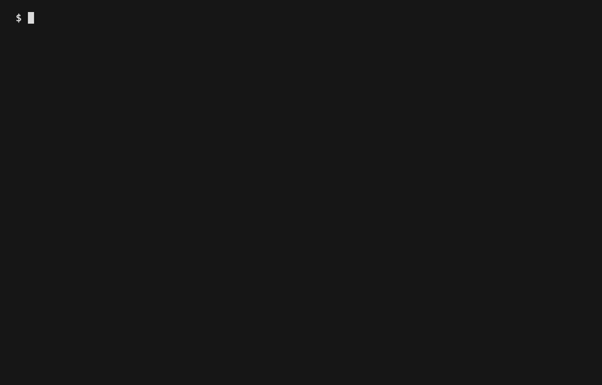

<p align="center">
  
  &nbsp;&nbsp;&nbsp;
  
</p>

# TradingAgents Crypto

暗号資産向けのマルチエージェント調査デスクです。アナリスト、強気と弱気の議論、リスク、ポートフォリオマネージャーが Buy、Hold、Sell に着地します。このフォークはその判断を [BYTtrade](https://byttrade.com) の [bytx](https://github.com/byttrade/bytx) で取引所へ送ります。

[English](../README.md) | [Русский](README.ru.md) | [中文](README.zh-CN.md) | [Español](README.es.md) | [Português](README.pt-BR.md) | **日本語** | [한국어](README.ko.md) | [Türkçe](README.tr.md)

## 二つの層

調査は TradingAgents のままです。執行は bytx です。Binance、Bybit、OKX、BingX、KuCoin、Bitget などを同じ呼び出しで扱います。ドライバは初期状態でオフです。オンにすると、live を選ぶまで注文は取引所の demo に出ます。

<p align="center">
  
</p>

<p align="center">
  
</p>

| 調査 | 執行 |
|---|---|
| Yahoo の価格とニュース、Reddit、StockTwits | 成行、または市場に近い post-only 指値 |
| Buy と Overweight はロングを開く | Underweight と Sell はポジションを閉じる |
| Hold と REVIEW は何も送らない | 株式は飛ばし、暗号資産だけを送る |
| ストップと目標はエージェントの判断 | OKX、KuCoin、Bitget、BloFin は passphrase が必要 |

図は [TauricResearch/TradingAgents](https://github.com/TauricResearch/TradingAgents) のものです。執行の画面と BYT のマークは [BYTtrade](https://byttrade.com) と [byttrade/bytx](https://github.com/byttrade/bytx) のものです。

## 誰が決めるか

<p align="center">
  
  
</p>

<p align="center">
  
  
</p>

アナリストはローソク足、指標、ニュースを読みます。強気と弱気が議論します。トレーダーが取引を提案し、ポートフォリオマネージャーが最終評価を付けます。暗号資産ではファンダメンタルズのアナリストは動きません。コインに企業の決算はないからです。

## 注文が取引所に届くまで

市場から 20 ベーシスポイント以内の指値は post-only で送られ、スプレッドを横断しません。それより遠い指値は通常の指値です。エントリー価格がなければ成行です。既定サイズは 100 USDT です。取引所の最小数量まで引き上げ、依頼したサイズの 3 倍は超えません。

<p align="center">
  
</p>

<p align="center">
  
</p>

## 起動

```bash
pip install ".[bytx]"
```

```env
BYTX_API_KEY=
BYTX_SECRET=
BYTX_PASSWORD=
BYTX_EXCHANGE=bybit
TRADINGAGENTS_EXECUTION_ENABLED=true
TRADINGAGENTS_EXECUTION_DEMO=true
TRADINGAGENTS_EXECUTION_NOTIONAL=100
```

`BYTX_PASSWORD` は API の passphrase です。必要なのは OKX、KuCoin、Bitget、BloFin だけです。Bybit と Binance はキーとシークレットで足ります。

```bash
tradingagents --ticker BTC-USD --execute
```

```python
from tradingagents.default_config import DEFAULT_CONFIG
from tradingagents.graph.trading_graph import TradingAgentsGraph

config = DEFAULT_CONFIG.copy()
config["execution"]["enabled"] = True
config["execution"]["demo"] = True

ta = TradingAgentsGraph(debug=True, config=config)
state, decision = ta.propagate("BTC-USD", "2026-11-14", asset_type="crypto")
print(decision, state.get("execution_result"))
```

ペーパーはキー不要です。`config["execution"]["paper"] = True`。これは投資助言ではありません。ライブでは損失が出ます。

上流の全文は英語です: [README.md](../README.md)。
