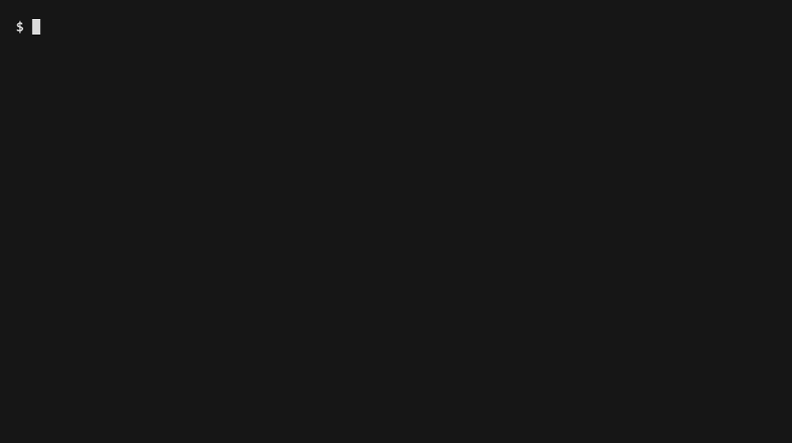
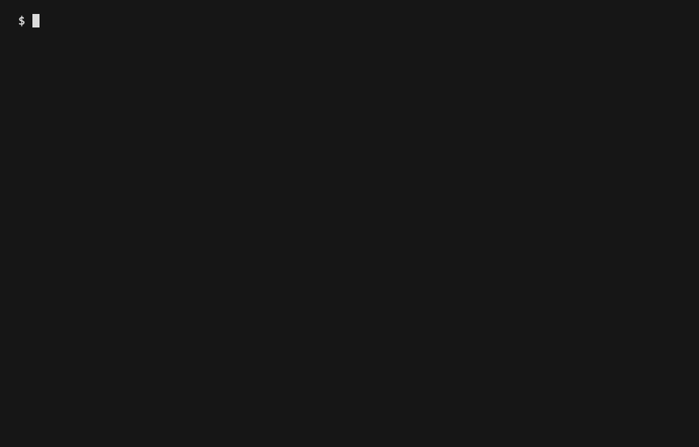

<p align="center">
  
  &nbsp;&nbsp;&nbsp;
  
</p>

# TradingAgents Crypto

Мультиагентный исследовательский стол для крипты. Аналитики, спор быков и медведей, риск и портфельный менеджер приходят к решению Buy, Hold или Sell. Этот форк отправляет решение на биржу через [bytx](https://github.com/byttrade/bytx) от [BYTtrade](https://byttrade.com).

[English](../README.md) | **Русский** | [中文](README.zh-CN.md) | [Español](README.es.md) | [Português](README.pt-BR.md) | [日本語](README.ja.md) | [한국어](README.ko.md) | [Türkçe](README.tr.md)

## Два слоя

Исследование остаётся у TradingAgents. Исполнение делает bytx: один вызов на Binance, Bybit, OKX, BingX, KuCoin, Bitget и другие площадки. Привод выключен по умолчанию. Если его включить, ордер идёт на demo, пока вы сами не выберете live.

<p align="center">
  
</p>

<p align="center">
  
</p>

| Исследование | Исполнение |
|---|---|
| Цены и новости Yahoo, Reddit, StockTwits | Рыночный ордер или post-only лимит рядом с рынком |
| Buy и Overweight открывают long | Underweight и Sell закрывают позицию |
| Hold и REVIEW ничего не отправляют | Акции пропускаются, на биржу уходит только крипта |
| Стоп и цель берут из решения агентов | OKX, KuCoin, Bitget и BloFin требуют passphrase |

Схемы стола взяты из [TauricResearch/TradingAgents](https://github.com/TauricResearch/TradingAgents). Кадры исполнения и знак BYT взяты у [BYTtrade](https://byttrade.com) и [byttrade/bytx](https://github.com/byttrade/bytx).

## Кто решает

<p align="center">
  
  
</p>

<p align="center">
  
  
</p>

Аналитики читают свечи, индикаторы и новости. Быки и медведи спорят. Трейдер предлагает сделку. Портфельный менеджер ставит итоговый рейтинг. Для крипты фундаментальный аналитик не запускается: у монеты нет отчётности компании.

## Как ордер доходит до биржи

Лимит в пределах 20 базисных пунктов от рынка уходит как post-only и не пересекает спред. Более далёкий лимит остаётся обычным. Без цены входа ордер рыночный. Размер по умолчанию 100 USDT. Он поднимается до минимума биржи и не больше чем в три раза от запрошенного.

<p align="center">
  
</p>

<p align="center">
  
</p>

## Запуск

```bash
pip install ".[bytx]"
```

```env
BYTX_API_KEY=
BYTX_SECRET=
BYTX_PASSWORD=
BYTX_EXCHANGE=bybit
TRADINGAGENTS_EXECUTION_ENABLED=true
TRADINGAGENTS_EXECUTION_DEMO=true
TRADINGAGENTS_EXECUTION_NOTIONAL=100
```

`BYTX_PASSWORD` — это passphrase API. Он нужен только OKX, KuCoin, Bitget и BloFin. Bybit и Binance обходятся ключом и секретом.

```bash
tradingagents --ticker BTC-USD --execute
```

```python
from tradingagents.default_config import DEFAULT_CONFIG
from tradingagents.graph.trading_graph import TradingAgentsGraph

config = DEFAULT_CONFIG.copy()
config["execution"]["enabled"] = True
config["execution"]["demo"] = True

ta = TradingAgentsGraph(debug=True, config=config)
state, decision = ta.propagate("BTC-USD", "2026-11-14", asset_type="crypto")
print(decision, state.get("execution_result"))
```

Paper без ключей: `config["execution"]["paper"] = True`. Это не финансовый совет. На live можно потерять деньги.

Полная документация upstream на английском: [README.md](../README.md).
